# Как выглядит моё железо

> Шпаргалка «что это за штука». Полный список с количеством и заметками лежит в [HARDWARE.md](HARDWARE.md).
>
> 📸 **Моё фото** означает, что это фото моей детали. **Похожее** означает справочное фото из интернета: у меня может быть другой цвет платы или другая ревизия, но форма и надписи те же. Источники: [hardware/reference/CREDITS.md](hardware/reference/CREDITS.md).
>
> Открыть с картинками: `Cmd+Shift+V` в VS Code.

**Быстрые ссылки:** [Сейчас: W01](#сейчас-w01-светофор) · [Платы](#платы) · [Датчики](#датчики) · [Ввод и вывод](#ввод-и-вывод) · [Моторы](#моторы-и-драйверы) · [Питание](#питание) · [Инструменты](#инструменты-и-расходники)

---

## Сейчас: W01 (светофор)

Всё, что нужно на этой неделе (EMB-1).

### Arduino Uno

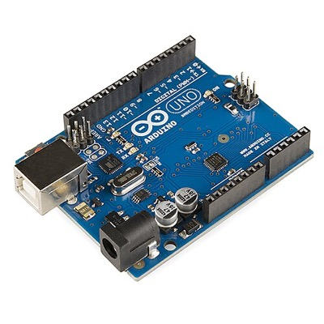 *похожее*

Синяя плата размером с ладонь. **Как узнать:** большой квадратный USB-разъём (тип B, как у принтера) и круглое гнездо питания рядом. По краям чёрные гребёнки с подписями пинов: сверху `D0…D13`, снизу `5V`, `3.3V`, `GND`, `A0…A5`.

### Макетка (breadboard)

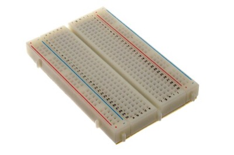 *похожее*

Белая пластина с дырочками. **Как устроена:**
- по длинным краям идут шины с красной (`+`) и синей (`−`) линией: все дырки вдоль линии соединены;
- в середине короткие ряды по 5 дырок, соединены поперёк;
- центральная канавка разделяет две половины, они **не соединены**.

У большой макетки шины часто разорваны посередине, проверь прозвонкой.

### Светодиоды

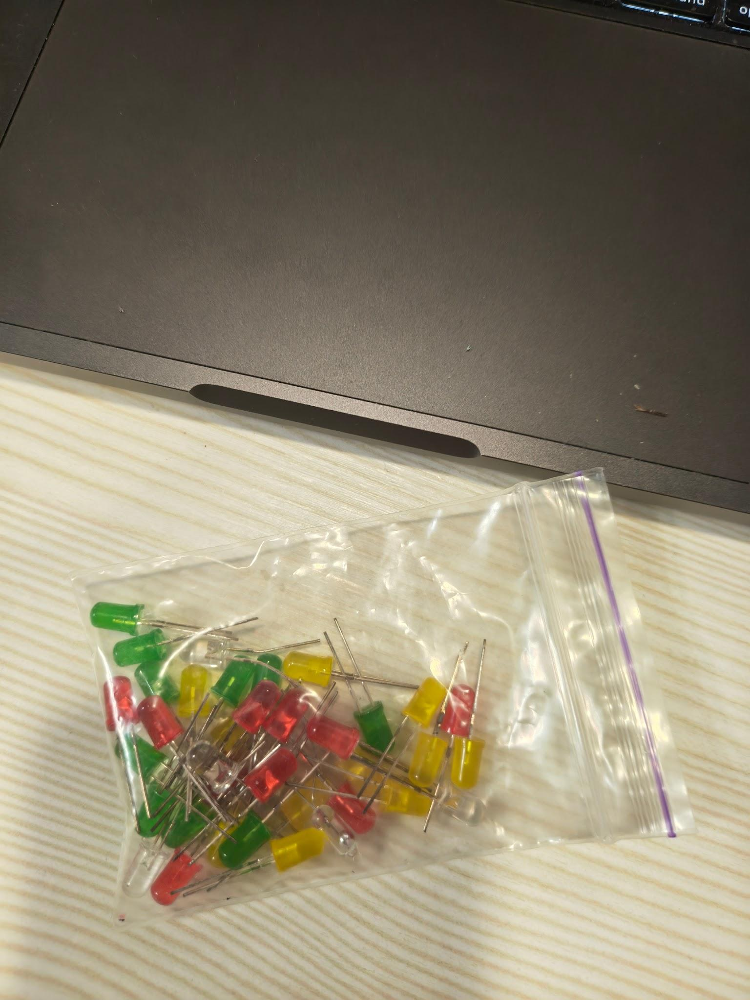 📸 *моё фото*

Цветные «капельки» 5 мм с двумя ножками. **Где плюс:**
- **длинная ножка = плюс** (анод), идёт к пину Arduino через резистор;
- короткая = минус (катод), идёт в GND;
- если ножки обрезаны: у минуса бортик корпуса **срезан** (плоская сторона), а внутри у минуса деталь крупнее.

### Резисторы

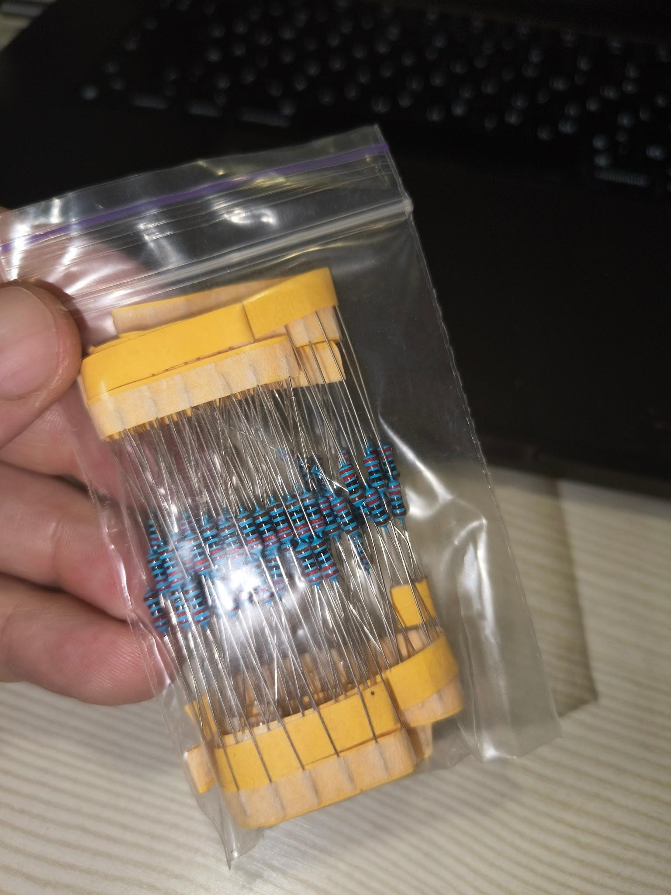 📸 *моё фото*

Голубые цилиндрики с цветными полосками, на бумажных лентах. Голубой корпус означает металлоплёночные с точностью 1%, у них **5 полос**: 3 цифры, множитель, точность (коричневая полоса, стоит чуть отдельно).

Нужные на W01:

| Номинал | Полосы (5 штук) | Зачем |
|---------|-----------------|-------|
| **330 Ом** | оранжевый, оранжевый, чёрный, **чёрный**, коричневый | светодиоды, сегменты индикатора |
| **220 Ом** | красный, красный, чёрный, **чёрный**, коричневый | синий/белый светодиод |
| **1 кОм** | коричневый, чёрный, чёрный, **коричневый**, коричневый | опыт с яркостью |
| **10 кОм** | коричневый, чёрный, чёрный, **красный**, коричневый | pull-down для кнопки |

Полосы легко спутать, поэтому **проверяй мультиметром** (режим Ω), это быстрее.

### Тактовая кнопка

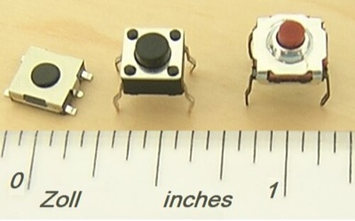 *похожее* &nbsp; 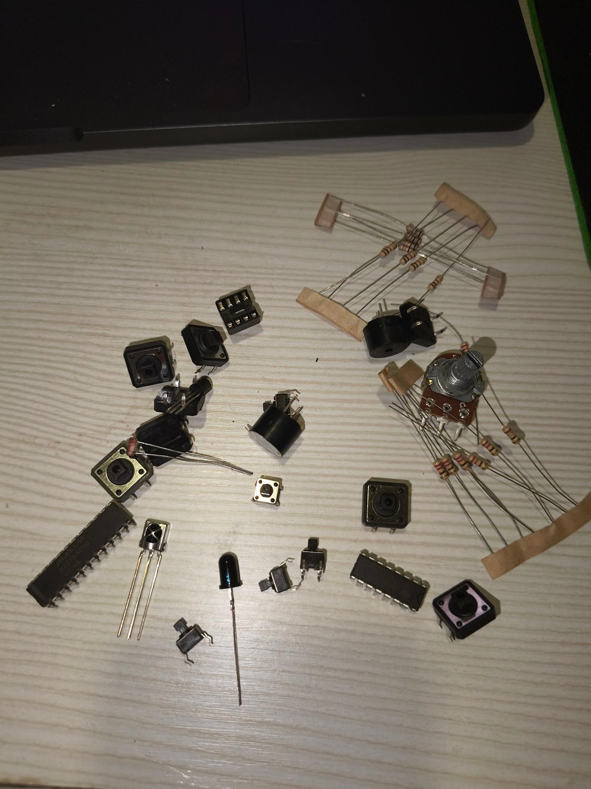 📸 *мои: кнопки, пищалки, потенциометр, микросхемы*

Квадратик с круглой «пуговкой» и **4 ножками**. Бывают маленькие (6×6 мм) и побольше (12×12 мм), обе подходят. Ножки попарно соединены всегда, нажатие соединяет пары между собой. Бери ножки **по диагонали**, тогда точно не ошибёшься.

### 7-сегментный индикатор 5161AS

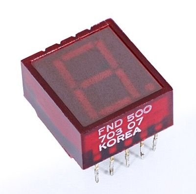 *похожее (другая модель, форма та же)*

Прямоугольный блок с цифрой «8» и точкой справа внизу, **10 ножек** (5 сверху, 5 снизу). У 5161AS обычно белые сегменты на тёмном корпусе, светятся красным. **Надпись `5161AS`** на боку корпуса. Распиновка в задаче EMB-1, шаг 4.

Рядом можно найти **5461AS-1**: такой же, но на 4 цифры и с 12 ножками. На этой неделе он не нужен.

### Пищалка (по желанию)

На моём фото выше: **чёрный цилиндр** ~12 мм с двумя ножками, сверху дырочка или наклейка. Если есть наклейка «Remove seal», это скорее всего **активная** пищалка (пищит сама от 5V). Без наклейки, с открытой платой снизу, скорее **пассивная** (нужен `tone()`). Проверка: подай 5V через Uno на секунду. Пищит, значит активная.

### Провода Dupont

Тонкие провода с пластиковыми наконечниками: **папа** (торчит штырёк) и **мама** (гнездо). Для макетки и Uno нужны **папа-папа**.

### Мультиметр

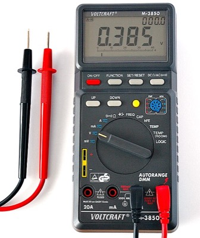 *похожее*

Экран, большая крутилка режимов и 3–4 гнезда для щупов:
- `COM`: **чёрный** щуп, всегда тут;
- `VΩ` (или `VΩmA`): **красный** для напряжения, сопротивления и прозвонки;
- `mA` / `10A`: красный **только** для замера тока, потом сразу вернуть обратно.

---

## Платы

| Фото | Что | Как узнать |
|------|-----|-----------|
|  | **Arduino Uno** (5V) | См. выше: большой USB-B и гнездо питания |
| 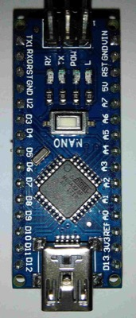 | **Arduino Nano** (5V) | Узкая длинная плата ~4.5×1.8 см, ножки снизу (втыкается в макетку), mini/micro-USB. Та же «начинка», что у Uno |
| 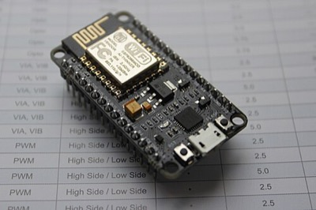 | **ESP8266** (3.3V) | Металлический экран с надписью `ESP8266MOD`, рядом зигзаг антенны на плате. ⚠️ 3.3V логика |
| — | **ESP32-C6-WROOM** (3.3V) | Похожа на ESP8266, но на экране написано `ESP32-C6-WROOM-1`. Обычно две USB-C (одна для прошивки, другая нативная) |
| 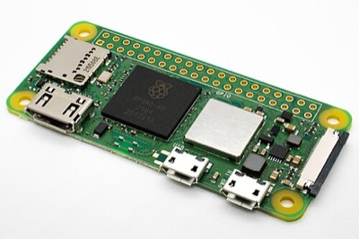 | **Raspberry Pi Zero W** | Зелёная плата размером с жвачку: mini-HDMI, два micro-USB, слот microSD, 40 дырок GPIO. На фото Zero 2 W, выглядит почти так же |
| — | **HC-06** (Bluetooth) | Синяя плата ~4×1.6 см с 4 пинами `VCC GND TXD RXD`, на ней маленький модуль с зигзагом антенны, мигающий светодиод |

## Датчики

| Фото | Что | Как узнать |
|------|-----|-----------|
| 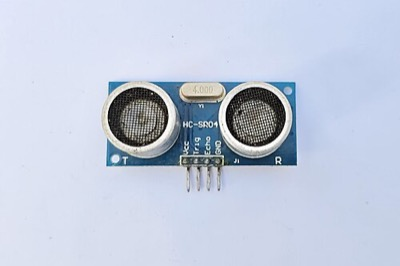 | **HC-SR04**, дальномер | Два серебристых «глаза» (`T` и `R`), 4 пина `VCC Trig Echo GND` |
| 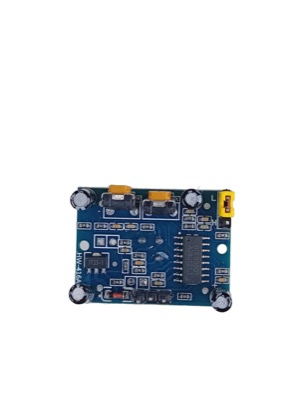 | **HC-SR501**, движение | Спереди белый пластиковый купол (на фото вид сзади), 2 оранжевых крутилки (чувствительность и время), 3 пина |
| 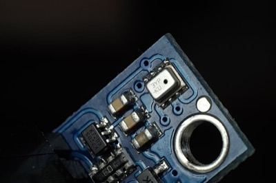 | **GY-BME280 / BMP280** | Маленькая фиолетовая/синяя платка ~1.5 см, крошечный серебристый квадратик с дырочкой (сам датчик), 4–6 пинов. Подпись `GY-BME280` / `GY-BMP280` |
| 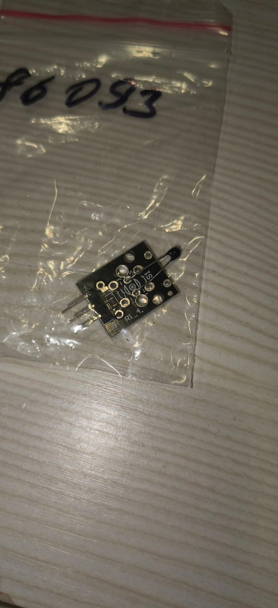 | **KY-013**, термистор | 📸 Платка с чёрной «капелькой» на ножках, 3 пина |
| — | **KY-022**, ИК-приёмник | Платка с чёрным 3-ногим элементом с выпуклостью-«линзой» спереди (как в телевизоре), часто с красным светодиодом |
| — | **3144E**, датчик Холла | Крошечный чёрный элемент с 3 ножками, плоский, с надписью `3144`. Похож на транзистор, но плоский |
| — | **FC-03**, датчик скорости | Платка с чёрной **П-образной** вилкой (щель для диска энкодера), 3–4 пина |
| 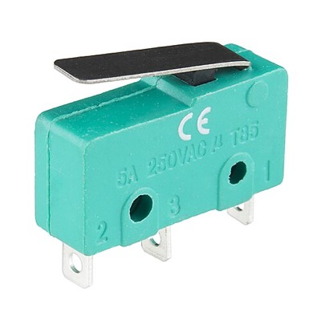 | **YL-99**, концевик | Платка с микропереключателем с металлическим рычажком (на фото сам переключатель) |
| 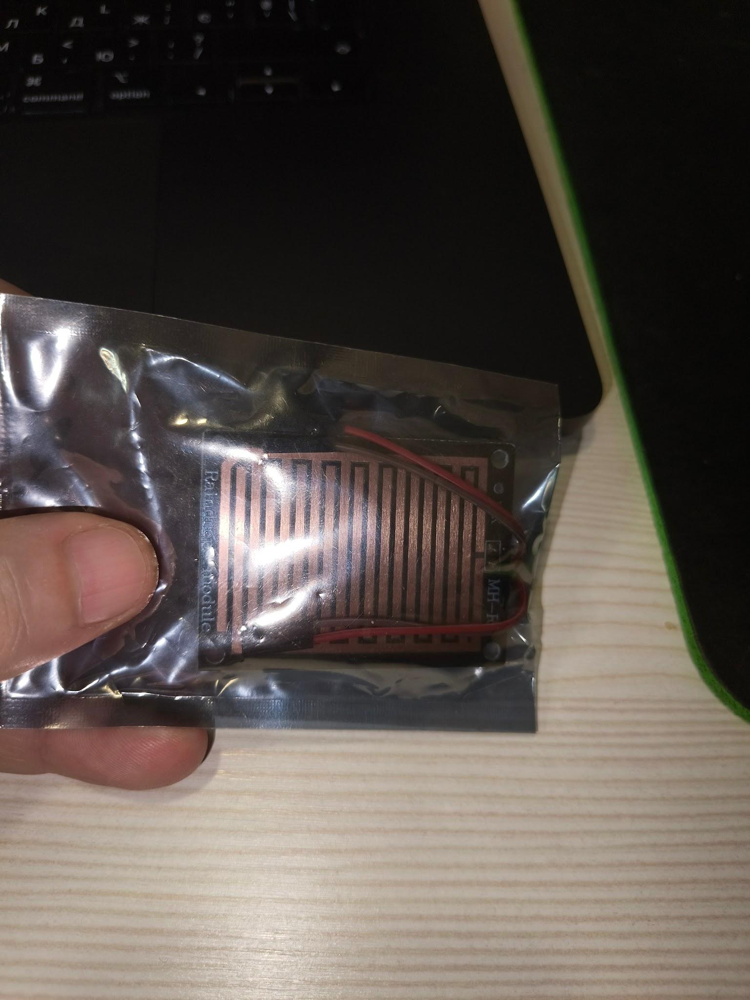 | **Датчик дождя** | 📸 Пластина с «гребёнкой» дорожек + отдельная платка с крутилкой |
| — | **Water sensor** | Длинная красная/чёрная платка с параллельными полосками-дорожками, 3 пина `S + −` |
| 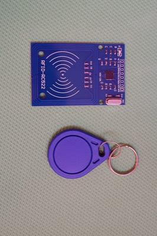 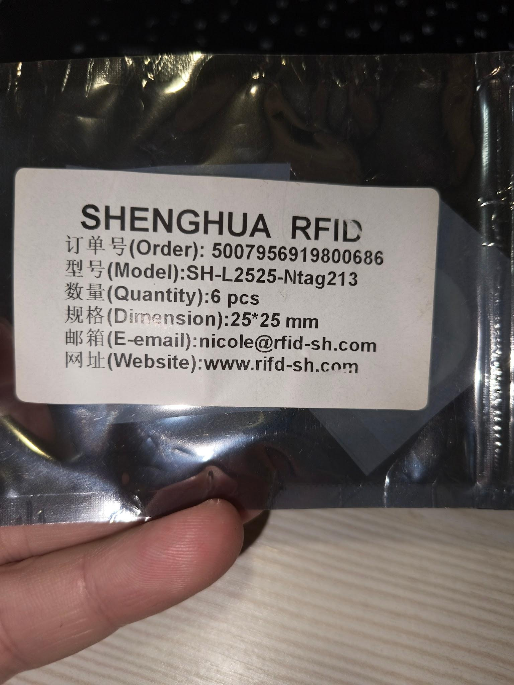 | **RFID-RC522** | Синяя плата с большой «катушкой» дорожек, 8 пинов. В комплекте карточка, брелок, 📸 наклейки. ⚠️ 3.3V |

## Ввод и вывод

| Фото | Что | Как узнать |
|------|-----|-----------|
| 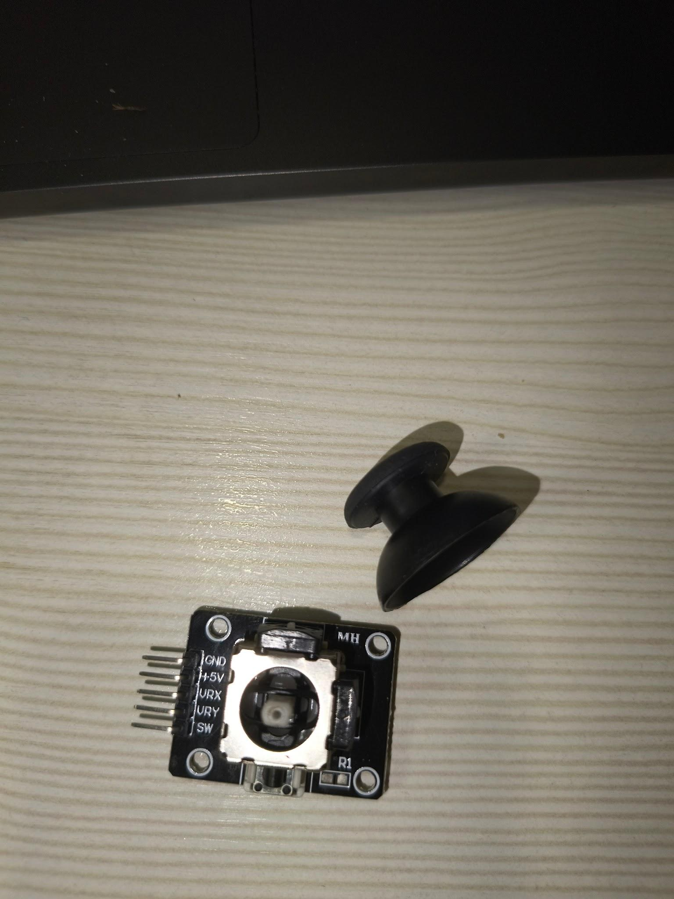 | **Джойстик KY-023** | 📸 Чёрная «шляпка» на платке, 5 пинов `GND +5V VRx VRy SW` |
| — | **Клавиатура 4×4** | Плоская плёнка с 16 кнопками (`0–9`, `A–D`, `*`, `#`) и шлейфом на 8 проводов |
| — | **LCD 1602A** | Зелёный или синий экран ~8×3.6 см, на 2 строки по 16 символов, 16 дырок в ряд сверху |
| — | **HW-233**, энкодер | Платка с металлической ручкой на резьбе, крутится бесконечно со щелчками, 5 пинов `CLK DT SW + GND` |
| — | **1088AS ×4**, матрица | Длинная плата с 4 квадратами 8×8 точек, микросхемы MAX7219 снизу |
| — | **1588AS**, матрица 8×8 | Один квадрат 8×8 точек, 16 ножек снизу, без платы |
| — | **5461AS-1** | Как 5161AS, но 4 цифры «8.8.8.8.» и 12 ножек |
|  | **5161AS** ×2 | См. W01 выше |
| 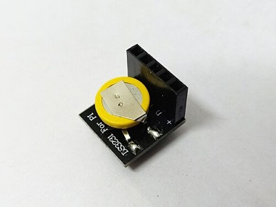 | **DS3231**, часы | Платка с держателем круглой батарейки CR2032 (жёлтой на фото). Моя может быть больше, с 6 пинами с одной стороны |
| 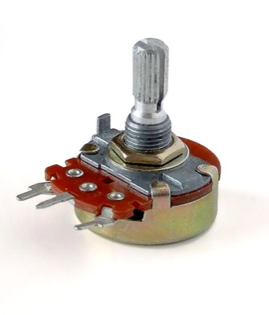 | **Потенциометр** | Круглый корпус с валиком-крутилкой, 3 ножки |
| 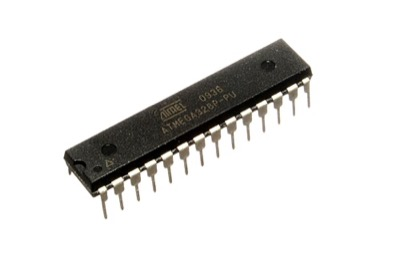 | **DIP-28** (ATmega328P?) | Длинная чёрная микросхема, 14 ножек с каждой стороны. Читать надпись сверху |
| 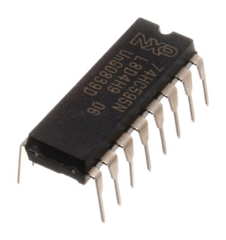 | **DIP-16** (74HC595?) | Короче: 8 ножек с каждой стороны. Надпись `74HC595` |

## Моторы и драйверы

| Фото | Что | Как узнать |
|------|-----|-----------|
| 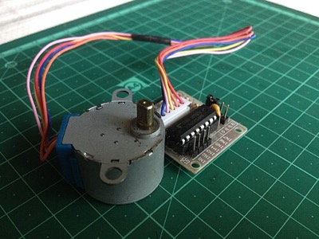 | **28BYJ-48 + ULN2003** | Круглый серебристый моторчик с синей крышкой, 5 цветных проводов в белой фишке. Плата драйвера с 4 светодиодами |
| 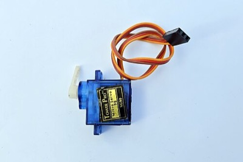 | **SG90**, серво | Синий полупрозрачный корпус, белая «качалка», 3 провода: коричневый (GND), красный (+5V), оранжевый (сигнал) |
| 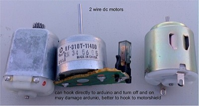 | **DC-моторчик** | Серебристый цилиндр с валом, 2 контакта-лепестка |
| — | **MX1508** | Крошечная красная или синяя платка ~2.5×2 см, 6 пинов-входов `IN1…IN4` и клеммы на 2 мотора |
| — | **IBT_2 (BTS7960)** | Большая плата с **алюминиевым радиатором** во всю плату, винтовые клеммы для мотора и питания |
| 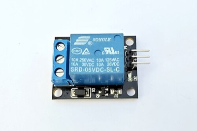 | **Реле JQC-3FF-S-Z** | Синий кубик ~2×1.5 см с надписью `JQC-3FF` (на фото похожий модуль `SRD-05VDC`). Если на плате с клеммником, значит модуль |

## Питание

| Фото | Что | Как узнать |
|------|-----|-----------|
| 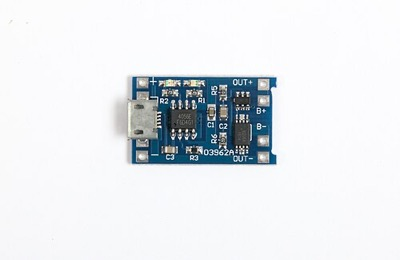 | **TP4056** ×3 | Синяя платка ~2.5×1.7 см с micro/USB-C, пады `B+ B−` (аккумулятор) и `OUT+ OUT−` |
| 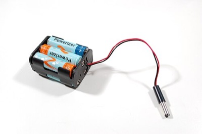 | **Отсек 6×AA** | Чёрный блок на 6 батареек. Ровно как на фото |
| 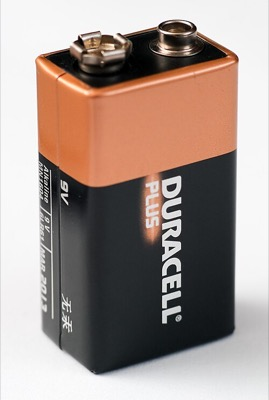 | **Крона 9V** | Прямоугольная батарейка с двумя кнопками-контактами сверху |
| 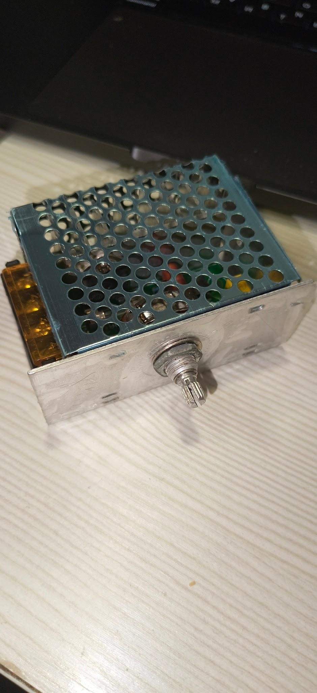 | ⚠️ **Блок с крутилкой** | 📸 Не опознан. **В сеть не включать** |
| — | **BTF-25-5** (5V 5A) | Металлический перфорированный корпус, винтовые клеммы `L N ⏚ V− V+` |
| — | **XH-W1209** | Платка с красным 3-значным дисплеем, 3 кнопками, реле и термодатчиком на проводе |

## Светодиодные ленты

| Фото | Что | Как узнать |
|------|-----|-----------|
| 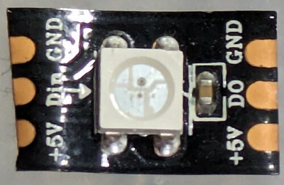 | **Адресная лента** (WS2812B) | На каждом светодиоде подписи `+5V DIN GND` с одной стороны и `+5V DO GND` с другой, стрелка показывает направление данных |

## Инструменты и расходники

| Фото | Что | Как узнать |
|------|-----|-----------|
|  | **Мультиметр** | См. W01 выше |
|  | **Макетка** | См. W01 выше |
| 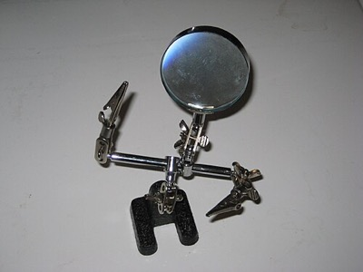 | **«Третья рука»** | Подставка с зажимами-крокодилами и лупой |
| 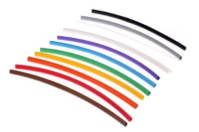 | **Термоусадка** | Цветные трубки, садятся от фена или паяльника |
| — | **DSO138** | Маленький осциллограф с цветным экраном ~2.4", 4 кнопками и BNC-разъёмом для щупа |
