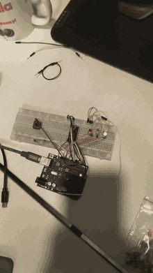
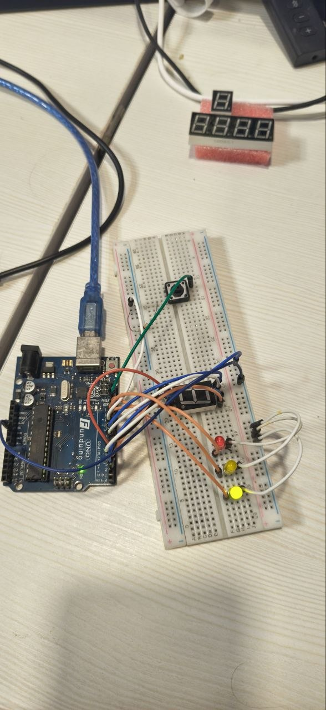

# 01 · Traffic Light with Pedestrian Button

> Week: W01 · Platform: Arduino Uno

🎥 Video: https://www.youtube.com/watch?v=e7iWiRZsFYM

## What it does
A car traffic light with a pedestrian button. The pedestrian presses the button, green blinks 3 times, then yellow, then red, and a 7-segment display counts down 9 → 0 while pedestrians cross. No `delay()` anywhere: the button is handled at any moment.

## Hardware
| Component | Qty | Notes |
|-----------|-----|-------|
| Arduino Uno (Funduino clone) | 1 | ATmega328P, 5V logic |
| Breadboard | 1 | |
| LEDs: red, yellow, green | 3 | |
| Tactile button | 1 | Internal pull-up (`INPUT_PULLUP`), no external resistor |
| 7-segment display 5161AS | 1 | Common cathode |
| 330 Ω resistor | 10 | 3 for LEDs + 7 for segments |
| Jumper wires (male-male) | ~14 | |

## Wiring
| Uno pin | Connected to | Notes |
|---------|--------------|-------|
| D2–D8 | display segments a–g | Each through its own 330 Ω resistor |
| GND | display COM (pin 3) | No resistor |
| D9 | button → GND | `INPUT_PULLUP`: released = 1, pressed = 0 |
| D10 | red LED → 330 Ω → GND | |
| D11 | yellow LED → 330 Ω → GND | |
| D12 | green LED → 330 Ω → GND | |
| D13 (on-board LED L) | — | On while a pedestrian is waiting |

## How it works
**State machine.** The traffic light has five states: `GREEN` → `GREEN_BLINK` → `YELLOW` → `RED` (with countdown) → `RED_YELLOW` → back to `GREEN`. Each state defines which lights are on and when to move to the next one.

**`millis()` instead of `delay()`.** `loop()` runs thousands of times per second and checks the clock every time: "how long have I been in this state?". The program never blocks, so a button press is never missed.

**Debouncing.** Button contacts bounce for a few milliseconds when pressed, so one press used to count as 2–3. A new button state is accepted only after it stays stable for 30 ms.

**7-segment display.** Each digit is stored as a byte where every bit is one segment (a–g). `showDigit()` walks through the 7 bits and turns the right segments on.

Code by step: [steps/03-button.cpp](steps/03-button.cpp) (button), [steps/04-display.cpp](steps/04-display.cpp) (display 0–9), [src/main.cpp](src/main.cpp) (full traffic light).

## Calculations
LED resistor: `R = (5 V − 2 V) / 10 mA = 300 Ω` → nearest standard value 330 Ω, current ≈ 9 mA.

Display: 7 segments × ~9 mA ≈ 63 mA total. The Uno handles up to ~200 mA for the whole chip and 20 mA per pin, so there is plenty of headroom.

## What I learned
- Ohm's law in practice: why an LED needs a resistor and how to size it.
- Multimeter: voltage, resistance, continuity, current (and why you never put it across a power supply in current mode).
- How a breadboard is connected inside.
- `INPUT_PULLUP` and why an input needs a pull-up.
- Contact bounce and debouncing with `millis()`.
- 7-segment display: common cathode, one resistor per segment, digits as bitmasks.
- State machines and non-blocking code without `delay()`.

## Issues
- **Firmware wouldn't upload (`not in sync`).** Switching to another USB port on the computer fixed it.
- **Green and yellow LEDs didn't light up.** Wires were in the wrong Uno sockets. Found it by feeding 5 V directly to the LED, bypassing the Uno: this instantly shows whether the problem is in the wiring or in the code.
- **Upload failed while Serial Monitor was open.** Only one program can use the serial port at a time. Fix: use Upload and Monitor.
