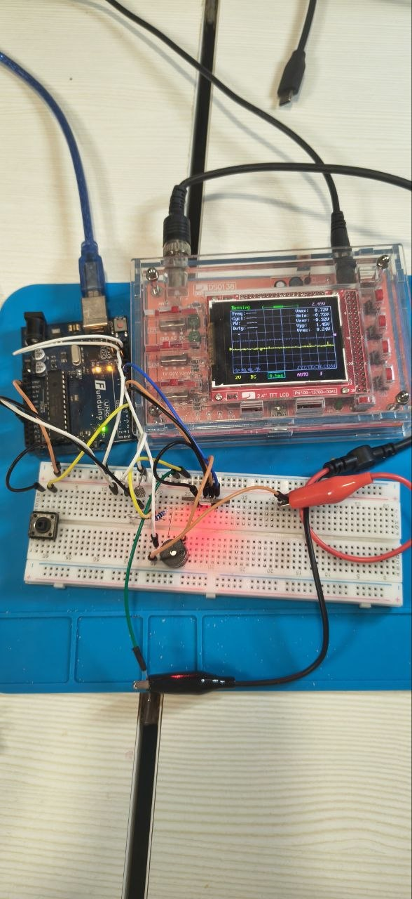
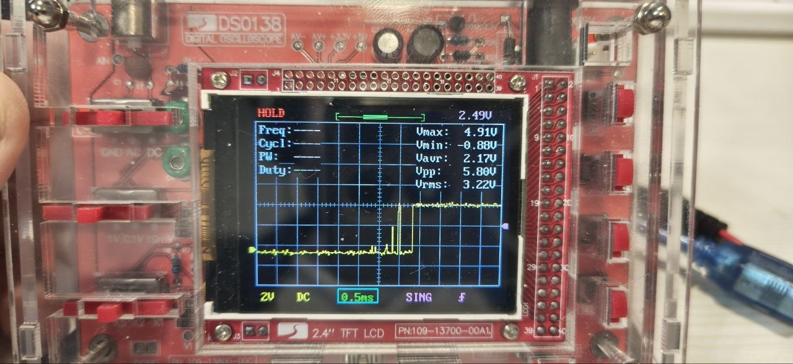
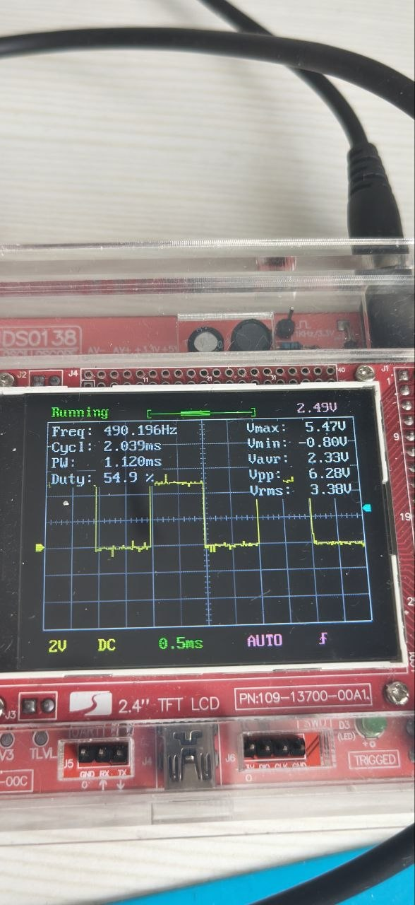

# 02 · Light Theremin

> Week: W02 · Platform: Arduino Uno

🎥 Video: https://youtube.com/shorts/sSS71Y4ssPM

## What it does
A musical instrument you play without touching it. Move your hand over a photoresistor: the buzzer pitch and the RGB color follow it. Hand close = low tone and blue, hand away = high tone and red. On start it calibrates for 3 seconds to your room light. A button mutes the sound, the color keeps working.

## Hardware
| Component | Qty | Notes |
|-----------|-----|-------|
| Arduino Uno (Funduino clone) | 1 | ATmega328P, 5V logic |
| Breadboard | 1 | |
| Photoresistor | 1 | Top half of a voltage divider |
| 10 kΩ resistor | 1 | Bottom half of the divider |
| Passive buzzer | 1 | Needs `tone()`; an active one would just beep on 5V |
| 220 Ω resistor | 1 | Limits buzzer current (pin max is 20 mA) |
| RGB module K851264 | 1 | Common cathode, resistors on board, real leg order `GND G B R` |
| Tactile button | 1 | `INPUT_PULLUP`, no external resistor |
| Oscilloscope DSO138 | 1 | For measurements, not part of the circuit |

## Wiring
| Uno pin | Connected to | Notes |
|---------|--------------|-------|
| 5V / GND | breadboard + / − rails | |
| A1 | divider middle (`c17`) | `5V ── photoresistor ── A1 ── 10 kΩ ── GND` |
| D8 | 220 Ω → buzzer → GND | `tone()` output |
| D5 | RGB red | PWM |
| D9 | RGB green | PWM |
| D6 | RGB blue | PWM |
| D2 | button → GND | Mute |

Pins 3 and 11 are not used for the RGB on purpose: `tone()` takes over Timer2 and kills PWM on them.

## How it works
**Voltage divider.** The ADC can only measure voltage, the photoresistor only changes resistance. Put it in a divider with 10 kΩ: dark → high resistance → low voltage on A1, bright → low resistance → high voltage.

**Calibration.** For the first 3 s the RGB blinks white and the sketch records the darkest and brightest A1 values while you wave your hand. Then `map()` stretches that range to 0…1000, so the instrument uses its full range in any room.

**Smoothing.** `smooth += (raw - smooth) * 0.3` is a simple low-pass filter: ADC jitter disappears, hand movement goes through.

**Sound and color.** Position 0…1000 → 200…2000 Hz with `tone()` and a color wheel from blue (240°) through green to red (0°) with three `analogWrite()` channels.

**No `delay()`.** Everything after calibration runs on `millis()`, so the button and the sensor are read 50 times per second. Data goes to [Teleplot](https://marketplace.visualstudio.com/items?itemName=alexnesnes.teleplot) at 115200 baud as `>light`, `>pos`, `>freq`.

Code by step:
[02-bounce](steps/02-bounce.cpp) ·
[03-pwm](steps/03-pwm.cpp) ·
[04-adc](steps/04-adc.cpp) ·
[05-divider](steps/05-divider.cpp) ·
[06-light-tone](steps/06-light-tone.cpp) ·
[07-rgb-colors](steps/07-rgb-colors.cpp) ·
[07-rgb-rainbow](steps/07-rgb-rainbow.cpp) ·
[08-theremin](src/main.cpp)

## Measurements

**Button bounce.** The code logged the time of every raw pin change with `micros()`. Pressing was always clean; *releasing* bounced in about 2 of 9 presses. Worst case: **29 changes in 2288 µs**, typical 170–350 µs. My 30 ms debounce from W01 has a ~13× margin.

**PWM on pin 10.** Period is 4 divisions × 0.5 ms = **2 ms → 490 Hz** (DSO138 measured 490.196 Hz). `analogWrite` 64 / 128 / 192 gives a high level of 1 / 2 / 3 divisions out of 4 = 25 / 50 / 75 % duty. Height is always 5 V, only the width changes.

**ADC.** Potentiometer gives 0…1023, noise at rest ±1 step (≈ 4.9 mV).

**Voltage divider, two 10 kΩ.** Multimeter 2.536 V, ADC 511 (2.50 V by code). The 5V rail is actually 5.07 V: the ADC measures a *fraction* of its own supply, so 511 is right, but converting to volts assuming exactly 5.00 V is a bit off.

On paper, R1 = 10 kΩ: R2 = 1 kΩ → 5 × 1 / 11 ≈ 0.45 V, R2 = 20 kΩ → 5 × 20 / 30 ≈ 3.33 V.

**Photoresistor on A1.** Palm on the sensor ≈ 106–110, room light ≈ 726–740, phone flashlight > 1000. Theremin calibration got dark = 110, bright = 740.

## What I learned
- Reading an oscilloscope: zero, trigger level and edge, `AUTO` vs `SINGLE`, time/div and V/div. DC vs AC coupling (always DC for logic, AC only to read frequency or ripple).
- Contact bounce is random and mostly happens on release here. Measure it, then pick the debounce time with a margin.
- PWM: a digital pin fakes "half power" by switching fast. Frequency stays the same, duty cycle changes. The eye sees brightness non-linearly.
- ADC: 10 bits, 0…1023, measured relative to the supply. USB 5V is not exactly 5V.
- Voltage divider: the bottom resistor gets its share of the total. This is how resistive sensors become voltages.
- Passive vs active buzzer, `tone()` and its side effect on PWM pins 3 and 11.
- RGB mixing. Labels on cheap modules can lie: test with a known sequence and fix the pin mapping in code.
- Low-pass filter and calibration make a sensor usable in any environment.

## Issues
- **Potentiometer switched the Uno off at the end of its travel.** Wires on two pot legs were swapped, the wiper was on a power line, and at the end stop 5V shorted to GND. Found with a multimeter in Ω mode. Details in [BUGS.md](../../BUGS.md).
- **Upload failed with `not in sync` / `protocol error`.** A forgotten Serial Monitor (or Teleplot) was holding the port. Only one program can use it at a time.
- **RGB colors came out shifted** (red showed green, green showed blue). The module label says `GND R G B`, the real order is `GND G B R`. Fixed by swapping pin numbers in code.

## Progress videos
- PWM on the oscilloscope: one button, four modes (breathe, 25%, 50%, 75% duty). 🎥 https://www.youtube.com/shorts/ApO5j_SK9C4
- Potentiometer → ADC → Teleplot: turning the knob, live `pot` and `volts` graphs next to the oscilloscope. 🎥 https://www.youtube.com/shorts/MY3ypWQqtcA
